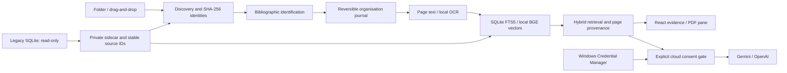

# Lab Research Agent v1 architecture

## Local workspace

React 19/TypeScript/Vite is served by FastAPI on localhost:8000. Library intake starts with the application, without indexing/audit/enrichment buttons. Original Streamlit code and the legacy database remain recoverable. The active branch is `codex/react-workspace`; main is not merged.

## Services and storage

- `backend/library.py`: read-only Phase 2 adapter and original index access.
- `backend/smart_library.py`: automatic discovery, durable jobs, lifecycle phases, incremental extraction/embeddings, source resolution and reconciliation. Newer discoveries are prioritised; metadata batches are bounded, and ready sources remain available.
- `backend/identification.py`: multiline/first-page metadata, reference-excluding DOI candidates, cached Crossref title/DOI lookup, OpenAlex fallback, field provenance and conservative confidence. Ambiguous identities remain provisional. PyMuPDF access is serialised across metadata threads.
- `backend/organiser.py`: configured-root boundaries, Windows no-replace moves, collision suffixes, journal recovery, undo/restore-all and explicit resume after rollback.
- `backend/ocr.py`: local image-only-page OCR; language assets download independently of confidential content. The original PDF is never rewritten. OCR-derived values are explicitly uncertain.
- `backend/cloud.py`: persistent policy/model preferences and turn/source snapshots, dynamic model discovery, provider adapters and citation/quotation checks. `backend/credentials.py` alone accesses Windows Credential Manager; secrets never enter API responses, logs or SQLite.
- Original `data/library.sqlite3`: remains unchanged, with all original vectors preserved. A consistent SQLite backup seeds `library.sqlite3.smart.sqlite3`; sidecar migrations affect only the copy. `.workspace.sqlite3` stores consent/preferences/history. All private stores, models, PDFs and recovery snapshots are ignored by Git.

## Safety and recovery

A single-worker Windows lock is acquired before sidecar initialisation/recovery. Each move commits a planned operation before the filesystem rename, verifies the content fingerprint afterwards, then binds attachment paths and completes the journal in one SQLite transaction. Startup reconciles unfinished operations conservatively. Ambiguous or conflicting states require attention; no destination is overwritten and no original is deleted.

Rollback similarly journals its intent, checks source and destination, restores the previous location and puts the content on organisation hold. Source links resolve via permanent document IDs and current attachments, including the filesystem/SQLite commit window. Changed bytes get a new identity; historical excerpts never silently point to replacement content.

Old source IDs are rebound only when every indexed passage occurs on the candidate's matching page. Unproven/rejected mappings cannot serve a potentially incorrect PDF; original records/vectors and rejection history are retained. Unchanged legacy content can reuse the old identity and vectors rather than being re-embedded.

The user's standing approval covers normal reversible organisation inside the configured root. Per-file confirmation is not required. This does not authorise deletion, overwriting, destructive index resets or unapproved provider processing.

## Cloud boundary and scientific reliability

The default and current policy is cloud off. Provider model IDs come from the configured account, rather than an invented static catalogue. AI On requires persistent excerpt-processing/possible-charge consent and a saved OS-vault credential. Only the question and bounded selected excerpts/bibliography are sent; full PDFs and local paths are not uploaded. OpenAI requests disable response storage. Provider errors preserve input; there is no automatic provider/cost fallback.

Generated answers must use known citation IDs and quotes matching their supplied source excerpts. These are provenance/string checks, **not independent entailment verification**. Experimental conditions and uncertainty remain essential; OCR may misread equations or numbers. Missing metadata stays unavailable, and provisional bibliographic matches are not represented as human-verified truth.

## Validation and remaining work

See [implementation plan](V1_IMPLEMENTATION_PLAN.md) for actual-corpus integrity and test results, and [development/operation](REACT_DEVELOPMENT.md) for launch, demo and recovery. The isolated browser demo uses synthetic PDFs, offline metadata/keyword retrieval and mocked provider UI calls. Live Gemini/OpenAI answering is deliberately unverified because the user requested keeping cloud processing off. Full scientific retrieval evaluation, richer publication/version identities, collections and independent claim review remain release work.
